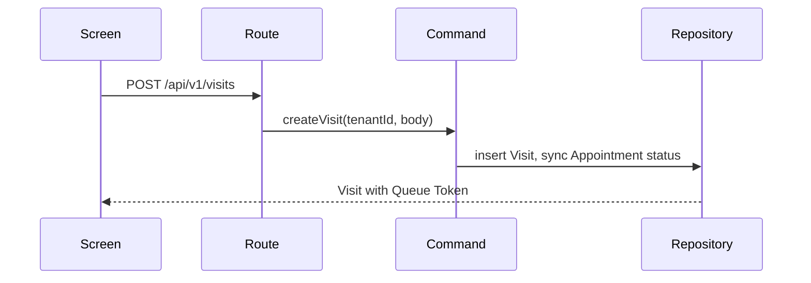

# Summary visuals

Adapted from Dex Horthy's `show-me` skill, by way of Matt Pocock's `pr`
skill. Pick the smallest view that makes the key point clear.

## Pseudocode: logic or an algorithm

```text
on(cancel appointment)
  if status is not Scheduled or Confirmed
    return conflict
  set status to Cancelled, record reason and time
  release the Doctor's slot reservations
```

## Call tree: runtime control flow

```text
POST /api/v1/appointments/{id}/cancel
  requireTenantSession
  cancelAppointmentCommand
    validateCancelAppointment
      appointmentRepository.findById
    appointmentRepository.cancelAppointment
```

## Component tree: UI structure, with the state and module boundaries that matter

```text
<AppointmentsPageImpl> (appointments/_components/appointments-page-impl.tsx)
  useQueryState('cancel')
  <AppointmentsTable>
  <CancelAppointmentDialog> (_modals/cancel-appointment-dialog.tsx)
```

## File tree: what each file is responsible for, or a broad refactor

```text
app/api/lib/modules/insurance-plan/
├── schemas/      # Zod schemas and inferred types
├── validator/    # schema parsing plus Payer existence check
├── commands/     # create, update, delete
├── queries/      # list by Payer, get by id
└── repository/   # all Drizzle access, tenant-filtered
```

## Mermaid: how components interact, control flow or data flow



## Diff sketch: what changes, when the surrounding shape already exists

Match the diff to the topic.

Component change:

```diff
 <AppointmentsPageImpl>
   <AppointmentsTable>
+    <CancelAppointmentAction />
   <AppointmentDetailSheet>
+  <CancelAppointmentDialog />
```

File layout change:

```diff
 app/(protected)/appointments/_components/
 ├── appointments-table.tsx
+├── _modals/
+│   └── cancel-appointment-dialog.tsx
-└── cancel-appointment.tsx
```

Call tree change:

```diff
 cancelAppointmentCommand
   validateCancelAppointment
+    permissionRepository.hasPermission
     appointmentRepository.findById
-  appointmentRepository.updateStatus
+  appointmentRepository.cancelAppointment
```

State or control flow change:

```diff
 on(check-in)
-  create Visit
+  if a non-cancelled Visit exists for this Appointment
+    return conflict
+  create Visit
+  set Appointment status to Checked In
```

## Full block: when most of it is new

Show the whole block when most of it is new, when leaving out context would
hide who owns what or the order things run in, or when the reviewer needs the
exact target shape:

```ts
export const cancelAppointmentSchema = z.strictObject({
  appointmentCancelledReasonId: z.coerce.number().int().positive(),
  note: optionalTrimmedString(255),
});
```

## Placement

Put each visual next to the short text it supports. Keep only the calls,
files, props, states and boundaries the reviewer needs to understand this
change.

You might use one of these or several. You will rarely need all of them. Use
judgement, and don't overwhelm the reviewer.
